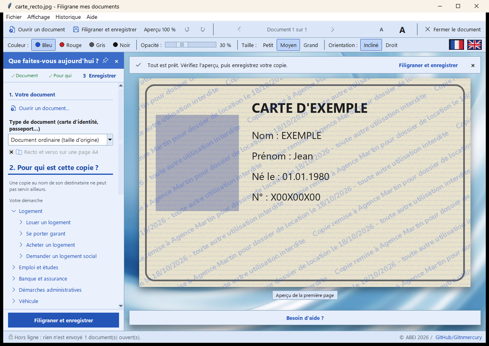
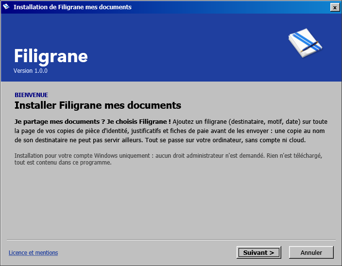
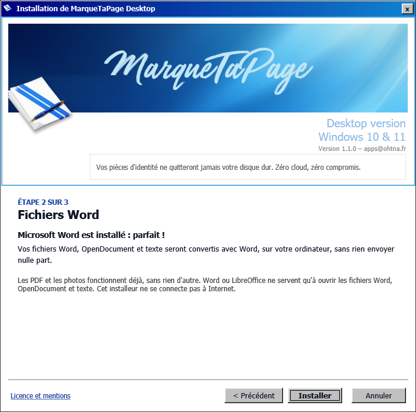
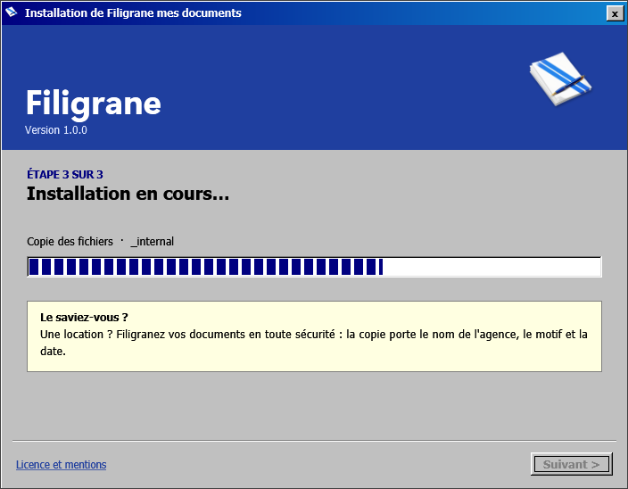
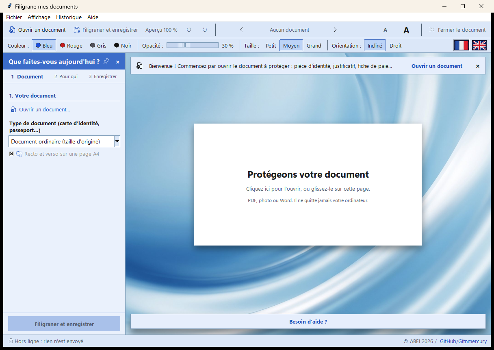
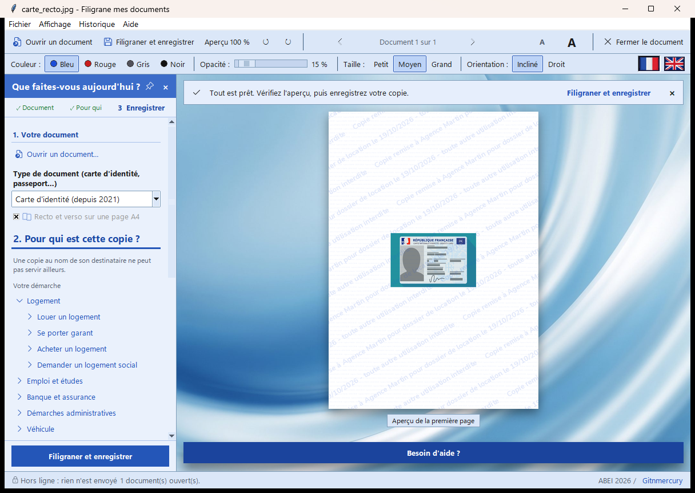
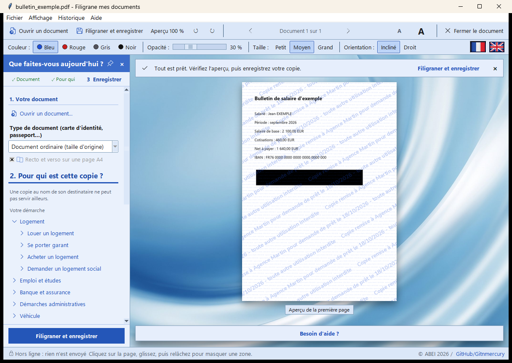
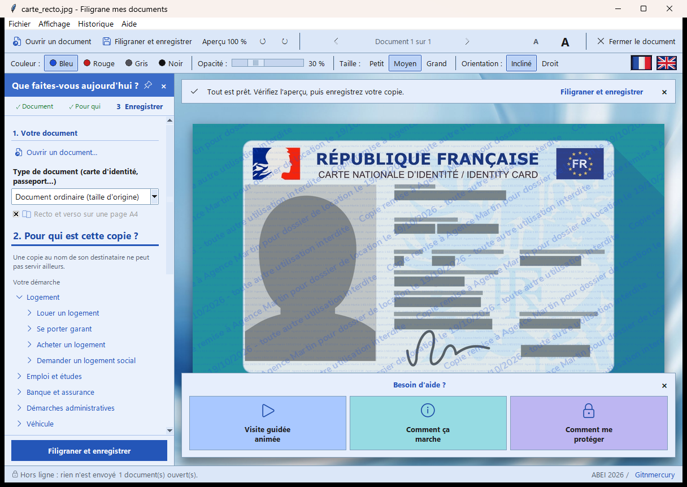
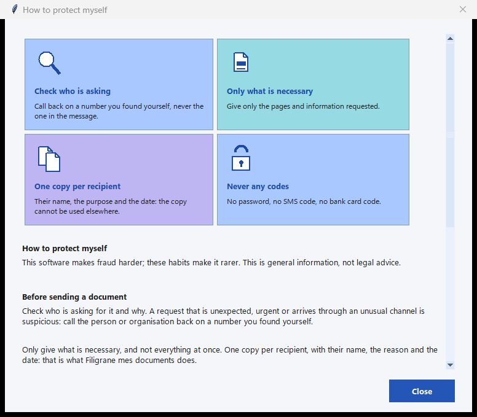

# MarqueTaPage Desktop

> **Vos pièces d'identité ne quitteront jamais votre disque dur. Zéro cloud, zéro compromis.**
>
> *L'État a son site en ligne, vous avez votre coffre-fort hors-ligne.*

Vous envoyez une copie de votre carte d'identité, d'un justificatif de domicile ou d'une fiche de paie ? MarqueTaPage y ajoute,
sur toute la page, le **nom du destinataire, le motif et la date**. Une copie « remise à l'agence Martin pour un dossier de
location le 18/10/2026 » ne peut plus servir à ouvrir un compte ou à souscrire un crédit ailleurs : elle se voit tout de suite.

**Tout se passe sur votre ordinateur** : pas de compte, pas de cloud, pas de télémétrie. Windows 10 / 11 et Linux
(Debian, Ubuntu). Interface en français et en anglais. Version **1.1.0**.

*(English: *Your files never leave your machine. Zero cloud. Total sovereignty.* MarqueTaPage adds a watermark with the recipient, the purpose and the date across the copies of your ID, proof of
address or payslips before you send them, to make identity theft harder. 100 % local. Windows 10/11 and Debian/Ubuntu.
English mode: click the flag at the top right.)*

## Télécharger

Les fichiers sont dans les **[Releases](../../releases/latest)** :

| Système | Fichier | Installation |
|---|---|---|
| Windows 10 / 11 | `install_marquetapage.exe` | double-clic ; aucun droit administrateur ; installe pour votre compte |
| Debian 12+, Ubuntu 24.04+ (64 bits) | `marquetapage-desktop_1.1.0_amd64.deb` | `sudo apt install ./marquetapage-desktop_1.1.0_amd64.deb` |

Vérifiez l'empreinte SHA-256 donnée dans les notes de la Release (Windows : `Get-FileHash install_marquetapage.exe` ;
Linux : `sha256sum fichier.deb`).

> **Windows peut afficher un avertissement** (« Windows a protégé votre PC »). L'installeur est signé avec un certificat
> d'auteur auto-signé, pas encore reconnu par Windows : si l'empreinte correspond, cliquez sur « Informations complémentaires »
> puis « Exécuter quand même ».

## L'installation (Windows)

Un assistant à l'ancienne, simple et sans surprise. Rien n'est téléchargé, rien n'est envoyé.

| | |
|---|---|
|  | **Bienvenue.** Installation pour votre compte uniquement, sans droit administrateur. Si une version est déjà installée, l'assistant propose de la mettre à jour, de la réinstaller ou de la désinstaller. |
|  | **Fichiers Word.** L'assistant regarde si Microsoft Word ou LibreOffice est présent (sans les lancer). Ils ne servent qu'à ouvrir les fichiers Word : les PDF et les photos fonctionnent sans rien d'autre. |
|  | **Installation.** Barre à blocs, et petites astuces d'usage pendant la copie des fichiers. Pour désinstaller ensuite : Paramètres › Applications › Applications installées. |

## Comment ça marche

Trois étapes ; la barre de conseil au-dessus de la page vous dit toujours la suivante.

**1. Ouvrez votre document.** Un clic sur la page blanche, ou glissez le fichier dessus : PDF, photo (JPG, PNG, WEBP, TIFF)
ou Word. Le volet de gauche se découvre au fil de la démarche : « 1. Votre document » d'abord, puis « 2. Pour qui » et
« 3. Protéger » dès qu'un document est ouvert.

**2. Dites pour qui est la copie.** Choisissez une démarche (location, emploi, banque, véhicule…) : le motif se remplit tout
seul. Indiquez le destinataire. L'aperçu montre le résultat en direct ; « Aperçu 100 % » montre le fichier exact (voir la
première image).

**3. Enregistrez.** Une copie est créée à côté de l'original, qui ne change jamais.

## Exemples

**Une carte d'identité en photo.** Choisissez son type : la carte est posée **à sa taille réelle** sur une page A4, recto et
verso ensemble, prête à imprimer. Son filigrane est plus léger (15 %) pour que la ligne de chiffres du bas reste lisible par
les services en ligne.

**Une fiche de paie en PDF.** Un IBAN, un numéro de sécurité sociale : dessinez un rectangle ou un rond sur la page, la zone
est pixellisée (gros carrés) pour de bon dans la copie. Les fichiers Word se traitent de la même façon (convertis sur votre ordinateur).

## Les outils et l'aide

- **Masquer une zone**, **copier l'image dans le presse-papiers** (pour la coller dans un formulaire sans créer de fichier),
  **réunir plusieurs documents** (recto, verso, justificatif) dans **un seul PDF**, rotation, aperçu à 100 %.
- Des **avertissements bienveillants** : destinataire trop vague, date passée.
- Trois thèmes (Bleu, Argent, Sombre), trois tailles de texte, un clavier complet.

La boîte « Besoin d'aide ? » sous le document se déplie en trois cartes : une visite guidée animée, « Comment ça marche »
et « Comment me protéger ».

« Comment me protéger » donne les bons réflexes et, **si vous êtes victime d'un vol ou d'une usurpation**, qui prévenir
(banque, police ou gendarmerie, cybermalveillance.gouv.fr, signal.arnaques.gouv.fr, service-public.fr, cnil.fr).

## Ce que fait le logiciel, et ses limites

- Le filigrane est répété sur **toute la page** et **fondu dans l'image** : on ne l'enlève pas comme un calque et rogner ne
  suffit pas. Une trame de très petits caractères couvre aussi les marges.
- Les informations cachées de l'original (position GPS d'une photo, appareil, auteur, titre) sont **retirées** ; le fichier
  produit ne porte ni le nom de l'éditeur ni celui du logiciel.
- Un filigrane rend la réutilisation frauduleuse d'une copie **plus difficile et plus visible** ; il ne peut pas l'empêcher
  dans tous les cas. Gardez vos originaux et vérifiez qui vous demande vos documents.

## Confidentialité

Aucune donnée ne quitte votre ordinateur : le programme coupe lui-même son accès au réseau. Seule exception, **sur votre clic**
(Aide › Vérifier les mises à jour) : il lit sur GitHub le numéro de la dernière version, et rien d'autre. Détails : [PRIVACY.md](PRIVACY.md).

## Licence

Libre d'utilisation **pour les particuliers, à titre privé** ; vente, location, redistribution hors du canal officiel, versions
modifiées diffusées et usage professionnel sont soumis à l'accord écrit du propriétaire. Texte complet : [LICENSE.md](LICENSE.md)
([English courtesy translation](LICENSE.en.md)) ; composants tiers : [THIRD-PARTY-NOTICES.md](THIRD-PARTY-NOTICES.md).

Éditeur : Anthony BELKACEM EI. Questions : apps@belkacem.fr · Licences : licence@ohtna.fr
